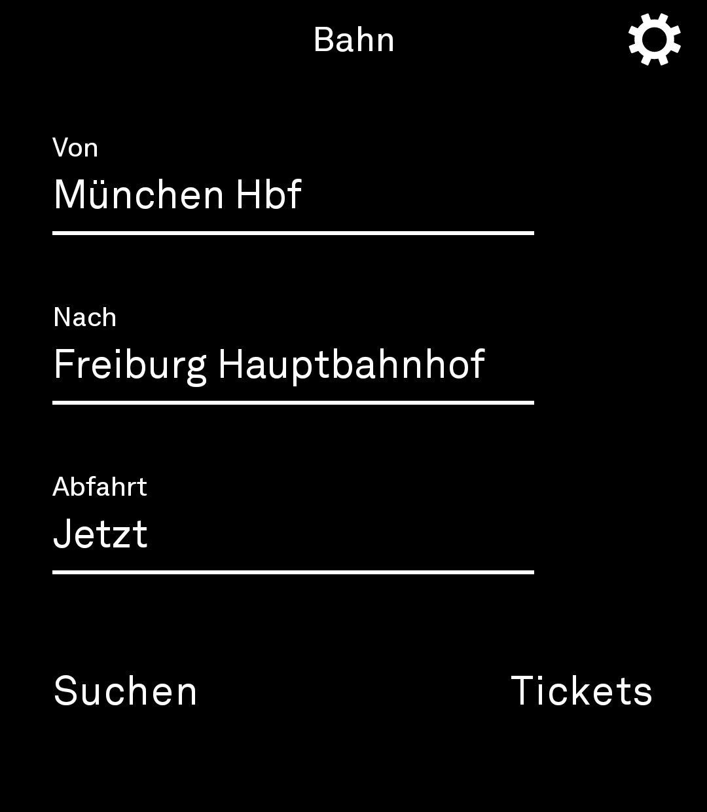
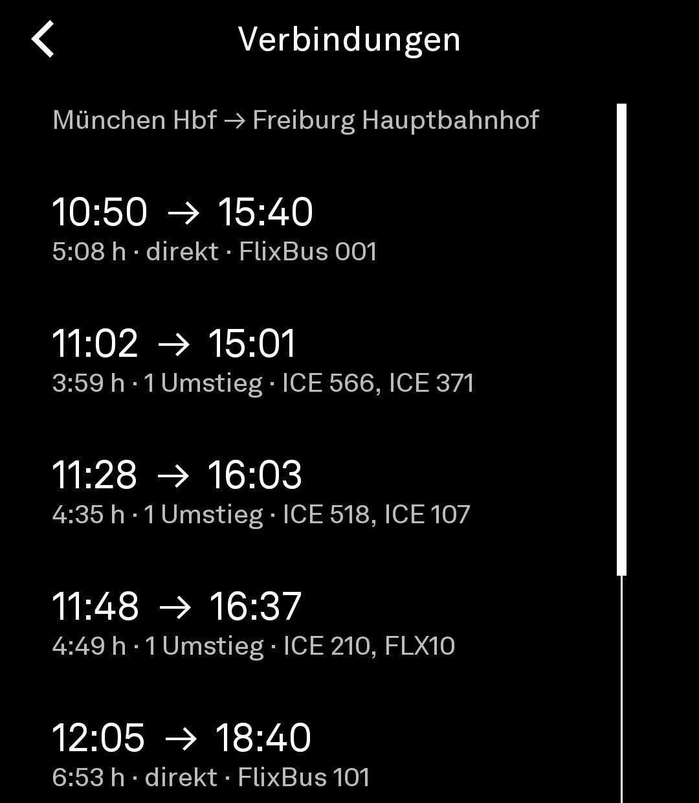
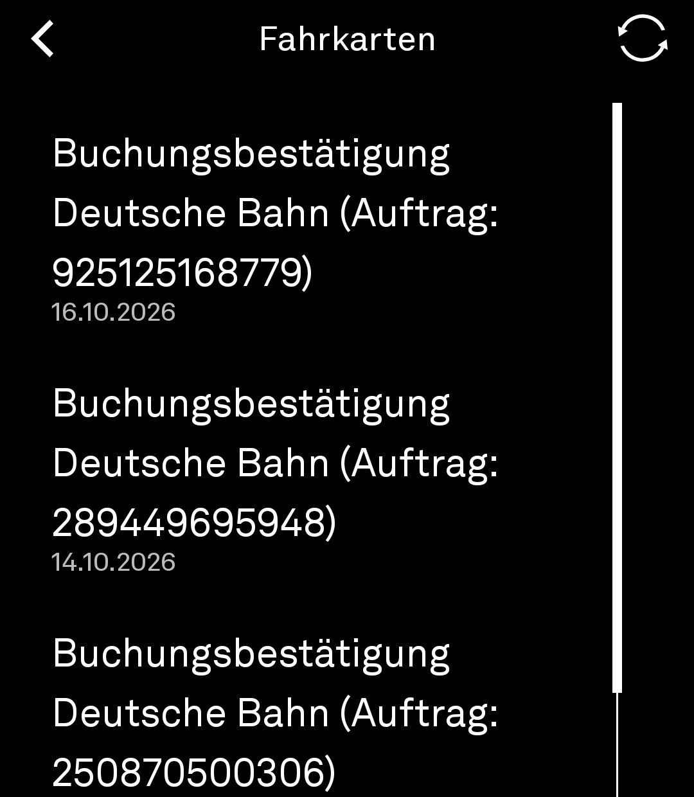

# FOX Gleis Light
Ich versuche mithilfe von Claude eine Bahn App für Deutschland zu programmieren.

## Ein ruhiges Tool für Bahn, Bus und Tickets auf dem Light Phone III
Verbindungen suchen und die Fahrkarte aus der Bahn-Mail anzeigen. Kein Konto bei der Bahn,
keine Werbung, kein Tracking.

<p>
  
  
  
</p>

**Was es kann**

- **Verbindungssuche:** Von/Nach eintippen, Bahnhof wählen, optional Tag und Uhrzeit der Abfahrt
  (Tag aus einer Liste wählen, dann z. B. `17:30` eintippen). Ergebnisse mit Verspätung, Umstiegen und Gleis,
  Gleiswechsel werden markiert. Die letzte Strecke bleibt gespeichert; „Tauschen“ dreht sie um.
- **Fahrkarten per Mail:** Das Tool liest eine eigene Ticket-Adresse (nicht dein normales
  Postfach) und holt per IMAP nur Mails von `bahn.de`, speichert deren
  PDF-Fahrkarten auf dem Telefon und zeigt den Barcode groß auf weißem Grund. Danach geht
  das auch offline. Unter einer Verbindung öffnet „Fahrkarte“ direkt das passende Ticket.

**Was es nicht kann**

- Tickets kaufen (dafür gibt es keine offene Schnittstelle).
- Das Deutschlandticket zeigen – dessen Code ist meist dynamisch.

## Datenquellen und Datenschutz

| Was | Wohin | Wozu |
|---|---|---|
| Bahnhofsnamen, Start/Ziel, Zeit | `api.transitous.org` (offener Community-Routenplaner, amtliche Fahrplandaten DELFI) | Fahrplan |
| Ticket-Adresse + App-Passwort | IMAP-Server des Anbieters, Port 993 (TLS, Hostname geprüft) | Ticket-Mails lesen |

- Das Postfach wird nur **lesend** geöffnet (`EXAMINE`, `BODY.PEEK`) – nichts wird als gelesen
  markiert, verschoben oder gelöscht.
- Gesucht werden nur Mails von `bahn.de` der letzten 120 Tage im Posteingang.
- Das App-Passwort liegt mit einem Schlüssel aus dem Android-Keystore verschlüsselt auf dem Gerät.
  „Vergessen“ in den Einstellungen löscht Zugang und alle gespeicherten Fahrkarten.

## Ticket-Adresse einrichten (einmalig)

Das Tool bekommt **nicht** dein normales Postfach, sondern eine eigene Adresse nur für Bahn-Tickets.

1. Eine neue Mailadresse anlegen, z. B. bei web.de oder GMX (`deinname.tickets@web.de`).
2. Dort den IMAP-Zugriff einschalten (web.de/GMX: Einstellungen → POP3/IMAP →
   „POP3 und IMAP Zugriff erlauben“).
3. Mit Zwei-Faktor-Anmeldung: ein **App-Passwort** anlegen und dieses im Tool eintragen.
4. Bei bahn.de unter „Mein Konto“ diese Adresse als E-Mail-Adresse hinterlegen.
   Bei Käufen ohne Konto einfach diese Adresse angeben.
5. Im Tool: Zahnrad → Adresse und App-Passwort eintragen → „Testen“.

**Server-Einstellungen** (Zahnrad im Tool): Protokoll **IMAP oder POP3**, Server, Port,
Verschlüsselung (**SSL/TLS oder STARTTLS**) und – bei IMAP – der Ordner. Leer gelassen wird alles
automatisch gewählt: Für web.de, GMX, Gmail, Posteo, mailbox.org, T-Online und iCloud kennt das Tool
die Server, sonst versucht es `imap.<domain>` bzw. `pop.<domain>`. SMTP wird nicht gebraucht, das ist
nur zum Senden. Bei POP3 löscht das Tool nichts; beim Anbieter sollte aber „Mails nach Abruf
löschen“ ausgeschaltet sein. Unverschlüsselte Verbindungen werden bewusst nicht unterstützt. Beim Öffnen der Ticket-Liste sucht das Tool
automatisch nach neuen Fahrkarten (höchstens alle 10 Minuten).

## APK bauen lassen (ohne eigene Entwicklungsumgebung)

1. Kostenloses Konto auf github.com anlegen.
2. Neues Repository erstellen (z. B. `bahn-light`), dann den Inhalt dieses Ordners hochladen
   („Add file → Upload files“, alles hineinziehen, „Commit“).
3. Unter **Actions** startet automatisch „Bahn-APK bauen“ (dauert ca. 5–8 Minuten).
4. Danach liegt unter **Releases → die neueste Version (z. B. „FOX Gleis Light 0.6.0“)** die Datei `FOX-Gleis-Light.apk`.

Lokal geht es auch mit Android Studio oder:

```
./gradlew :tool:assembleDebug -DlightSdk.toolOnly=true
```

## Aufs Light Phone bringen

**Variante A – Tool Manager über WLAN (ohne Kabel)**

1. Im [Light-Dashboard](https://dashboard.thelightphone.com) den Entwicklermodus einschalten.
2. Telefon und Computer ins selbe WLAN, auf dem Telefon in den Einstellungen den Tool Manager
   starten und die angezeigte Adresse im Browser am Computer öffnen.
3. Unter `Developer` → `Developer Keys` die Datei
   [`docs/sideloading/light_debug_signing_key.txt`](docs/sideloading/light_debug_signing_key.txt)
   hochladen. (Das ist der Fingerabdruck des SDK-Entwicklerschlüssels, mit dem die APK signiert ist.)
4. Unter `Upload Tools` die `FOX-Gleis-Light.apk` hochladen. Nach kurzer Zeit erscheint „Gleis“ in der Toolbox.

Siehe auch die offizielle Anleitung in [`docs/sideloading`](docs/sideloading/README.md).

**Variante B – per Kabel mit adb**

1. Entwickleroptionen und USB-Debugging am Light Phone aktivieren.
2. Android platform-tools (adb) am Computer installieren, dann: `adb install FOX-Gleis-Light.apk`

## Aufbau

Der Code des Tools liegt in [`tool/src/main/kotlin/io/github/lightbahn`](tool/src/main/kotlin/io/github/lightbahn):

| Datei | Inhalt |
|---|---|
| `BahnScreen.kt` | Oberfläche mit den Bausteinen der Light SDK |
| `BahnViewModel.kt` | Zustand, Navigation, Speichern |
| `BahnApi.kt` | Fahrplan-Abfragen (Transitous) |
| `ImapClient.kt` | kleiner, nur lesender IMAP-Client (die SDK erlaubt keine Mail-Bibliothek) |
| `MimeParser.kt` | holt Betreff, Text und PDF-Anhänge aus der Mail |
| `TicketStore.kt` | lokale Ablage der Tickets, verschlüsseltes Passwort |
| `TicketRenderer.kt` | rendert das PDF und schneidet den Barcode unverändert aus |
| `Formatting.kt` | Zeiten, Verspätungen, Eingabe der Abfahrtszeit |

Der Rest des Repos ist die [Light SDK](https://github.com/lightphone/light-sdk) (Stand Oktober 2026),
deren ursprüngliche README in `README.light-sdk.md` liegt.

## Für die offizielle Tool-Bibliothek

Light verlangt Open Source und prüft u. a. Datenschutz und rechtliche Fragen. Der Zugriff auf ein
fremdes Postfach und die inoffizielle Fahrplan-API könnten bei der Prüfung Fragen aufwerfen.
Für den Eigengebrauch per Sideload spielt das keine Rolle.
